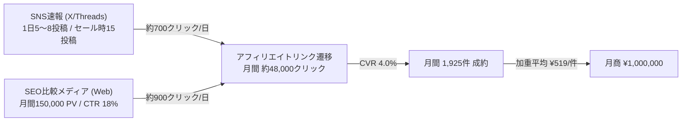

# 楽天アフィリエイト × Amazonアソシエイト 月100万円達成ブループリント（2026年版）

> [!IMPORTANT]
> 本プランは **2026年11月時点の公式仕様・規約** に完全準拠して設計しています。
> - **楽天ウェブサービス**: 2026年移行後の新ドメイン `openapi.rakuten.co.jp`（UUID形式 `applicationId` + `accessKey` ヘッダ認証 + 接続元許可IP/ドメイン）、商品検索 `IchibaItem/Search/20260701`・ランキング `IchibaItem/Ranking/20220601`
> - **楽天アフィリエイト**: 通常商品（1商品1,000円上限・同一ユーザー月3,000円上限）ではなく、**「料率アップ対象商品（最大20%・上限なし）」** をAPIで自動抽出して狙う戦略
> - **Amazonアソシエイト**: 1商品1,000円上限廃止済み。旧PA-API 5.0は2026年5月に廃止され **Amazon Creators API（直近30日で10件の適格販売が必要）** へ完全移行済み。API未承認の現時点では **公式特別プログラム（API不要・単価500〜3,000円）** と **ツールバー/ASIN手動リンク（非スクレイピング厳守）** で最短で30日10件を達成してAPIを解放する設計

---

## 1. 月100万円の収益ポートフォリオ数理設計

通常の低単価物販（1件あたり報酬 100〜150円）だけで月100万円に到達するには、月間7,000〜10,000件の成約が必要となり、個人運用では再現性が低くなります。
そこで、**単価・料率の天井が外れている4つの柱** を組み合わせ、**加重平均報酬単価 ¥519/件 × 月間1,925件（約64件/日）** で月100万円を達成する設計とします。

| 収益の柱 | 狙う領域・仕組み | 報酬単価の根拠（2026年最新） | 目標成約数/月 | 月間収益目標 | API要否 |
|---|---|---|---:|---:|---|
| **柱① 楽天「料率アップ上限撤廃」自動発掘** | 楽天APIで `affiliateRate >= 5%`（最大20%）かつ高レビュー商品を自動抽出し、Webランキング＋X速報で配信 | 料率アップ商品は **1,000円上限＆月3,000円上限が免除**。平均単価 ¥6,000 × 10% = **¥600/件** | 550件 | **¥330,000** | 楽天API（済） |
| **柱② 楽天「イベント・まとめ買い」クッキー横断回収** | 0と5のつく日 / お買い物マラソン / 楽天スーパーSALEに連動した日用品・食品・ふるさと納税まとめ | クリック後24時間以内カゴ投入・89日以内購入で **ショップ横断成果**。平均 **¥250/件** | 800件 | **¥200,000** | 楽天API（済） |
| **柱③ Amazon「公式特別プログラム」高単価CPA** | SEO比較記事＋LP（`/programs`）＋SNS導線で無料体験・法人登録へ送客 | **Amazonビジネス ¥3,000** / **Audible ¥2,000** / **Kindle Unlimited・Music Unlimited・Prime Student ¥1,000** / **Prime ¥500**。平均 **¥1,600/件** | 175件 | **¥280,000** | **不要（即稼働）** |
| **柱④ Amazon「高料率5〜8%＋上限なし高単価」比較導線** | 比較カード（楽天＋Amazon並列）と特化比較ガイド。初期はツールバー/ASIN手動登録→10件達成後にCreators API自動同期へ切替 | 食品/ファッション **8%**・コスメ/ドラッグストア **5%**・家電/PCは **1,000円上限なし**。平均 **¥475/件** | 400件 | **¥190,000** | 初期不要→後で解放 |
| **合計** | **ハイブリッド（SNS速報 × SEO比較メディア × 自動運用）** | **加重平均 ¥519/件** | **1,925件** | **¥1,000,000** | — |

### トラフィック＆KPI逆算

- **必要リンククリック数**: 月間 **48,000クリック**（1日あたり約1,600クリック、合算CVR 4.0%想定）
  - 内訳目安: SNS直リンク＋SNS→Web経由 **約21,000クリック/月** ＋ SEO自然検索経由 **約27,000クリック/月**
- **EPC（1クリックあたり期待収益）**: 全体平均 **¥20.8/クリック**（通常物販の平均¥5〜10の2〜4倍。楽天料率アップ＋Amazon特別プログラムの組み合わせで実現）

---

## 2. フェーズ別実行ロードマップ（0円 → 月100万円）

### Phase 1（Day 1〜30）：基盤稼働 & Amazon Creators API 最短解放（目標：月3万〜10万円）

1. **本日構築したWebメディア「トクラボ」をVercel等へ公開**
   - `.env.local` に楽天 `applicationId` / `accessKey` / `affiliateId` と Amazon `trackingId` を設定
   - GitHub Actions（6時間毎）または固定IPサーバーで `npm run sync:rakuten` を自動実行し、最新の料率アップ＆高還元商品を常時更新
2. **Amazon「直近30日で10件販売」を最速突破（Creators API解放）**
   - API不要の **柱③（Audible ¥2,000 / Kindle Unlimited ¥1,000 / Amazonビジネス ¥3,000）** の特集ページと、ツールバー生成リンクを貼った **売れ筋日用品・ベストセラー比較記事10本** を優先公開
   - X（旧Twitter）で「0と5のつく日」「Amazonタイムセール」「無料体験キャンペーン」を1日5投稿（`/ops` スタジオからワンクリック生成＆コピー）
3. **10件達成後**: Amazon Associates Centralで **Creators API（OAuth 2.0）** の認証情報を発行し、本リポジトリ実装済みの `src/lib/amazon/creators-api.ts` を有効化

### Phase 2（Month 2〜3）：SNS×比較記事の勝ちパターン横展開（目標：月15万〜40万円）

1. **データによる勝ちジャンル集中投下**
   - 楽天レポート・Amazonレポートからクリック率（CTR）と成約率（CVR）上位3ジャンルを特定（典型例：美容スキンケア、日用品まとめ買い、PCデスク＆ガジェット、読書＆Audible）
2. **SEO比較ガイドを週5本ペースで50本へ拡充**
   - 「商品名＋実質最安」「楽天とAmazonどっちが安い」「ジャンル名＋おすすめ比較」「Audible＋おすすめ本」等の購買直前キーワードを網羅
3. **楽天イベント連動の予約投稿自動化**
   - 毎月5・10・15・20・25・30日（0と5のつく日）と月2回のお買い物マラソン開始2時間前（半額クーポン配布時）に集中投下

### Phase 3（Month 4〜6）：月100万円スケール体制（目標：月60万〜100万円+）

1. **Creators API完全統合による「リアルタイム楽天vsAmazon実質価格比較」**
   - ポイント還元まで加味した実質最安比較表を自動更新し、検索上位（ロングテール数千語）のCVRを最大化
2. **高単価Amazon特別プログラムの専門特集ハブ強化**
   - 法人・個人事業主向け「Amazonビジネス（¥3,000/件）」記事群、通勤・読書層向け「Audible（¥2,000/件）」作品別レビュー群を量産
3. **SNSマルチチャネル展開（X＋Threads＋LINEオープンチャット/公式LINE）**
   - セール通知のリスト化（リピーター化）により、Googleアルゴリズム変動に左右されない安定月商100万円を確立

---

## 3. 絶対に守るべき規約・法令コンプライアンス（BAN防止）

> [!CAUTION]
> アフィリエイトアカウントの凍結は収益ゼロに直結します。本システムには自動チェック（`npm run check:compliance`）を組み込んでいますが、運用時も以下を厳守してください。

1. **Amazonスクレイピング絶対禁止**
   - Creators API承認前にAmazonの商品ページをスクレイピングして画像・価格・レビューを取得することは運営規約違反。
   - 本システムでは、API未承認フェーズは **アソシエイト・ツールバーで作成したリンク / ASIN直リンク / 検索リンク / 公式特別プログラムLPリンク** のみを使用し、価格等の取得は一切行いません。
2. **楽天APIデータの利用条件遵守**
   - 楽天ウェブサービスAPIで取得した商品情報・画像を表示するカードには、**必ず楽天アフィリエイトリンクを併置**します（楽天リンクなしでAmazonリンクだけ貼るのは規約違反）。
   - APIは1.5秒以上のリクエスト間隔と429リトライ制御を行い、2026年新仕様の **許可IP（バックエンド型）または許可ドメイン（Webアプリ型）** を正しく設定します。
3. **必須クレジット・ステマ規制（景品表示法）表記**
   - 全ページ上部に `PR / 本ページはプロモーション（アフィリエイト広告）を含みます` を表示。
   - 全SNS投稿に `#PR` を自動付与。
   - サイトフッターに **「Amazonのアソシエイトとして、［サイト名］は適格販売により収入を得ています。」** および **Rakuten Developers クレジット** を常時表示。
   - 価格・ポイント倍率は常に変動するため、取得日時と「最新情報は販売ページでご確認ください」を明記。

---

## 4. 本リポジトリで構築・実行したシステム構成

このプランを机上の空論で終わらせないため、`Keigaku/programming` に以下のプロダクションシステムを構築済みです：

- **公開比較メディア（Next.js App Router / SEO最適化）**
  - `/` トップページ（本日の高還元・料率アップランキング、楽天イベント自動判定バナー、Amazon高単価特別プログラム特集、厳選比較ガイド）
  - `/deals` リアルタイム絞り込み・実質最安比較カタログ
  - `/programs` Amazon公式特別プログラム（Audible ¥2,000 / Amazonビジネス ¥3,000 等）専用高CVR比較ページ
  - `/guides` & `/guides/[slug]` 購買直前キーワード向けSEO比較記事（構造化データ JSON-LD 対応）
- **運用コマンドセンター（`/ops`）**
  - 月100万円KPIインタラクティブシミュレーター
  - 楽天API「料率アップ（上限撤廃）」スコア一覧＆ワンクリック同期実行
  - Amazon手動ASIN/ツールバーリンク管理＆「Creators API解放（30日10件）」進捗トラッカー
  - X/Threads/LINE向け `#PR` 自動付与SNS投稿ジェネレーター（140字チェック＆CSV一括出力）
- **自動化CLI & CI/CD**
  - `npm run sync:rakuten` — 2026年新楽天API対応・高料率＆ランキング自動収集＋Yield Score算出
  - `npm run sns:generate` — 時間帯別SNS投稿キュー（JSON / CSV）自動生成
  - `npm run check:compliance` — PR表記・楽天リンク併置・規約自動監査
  - `.github/workflows/sync-deals.yml` — 6時間ごとの自動データ更新ワークフロー
